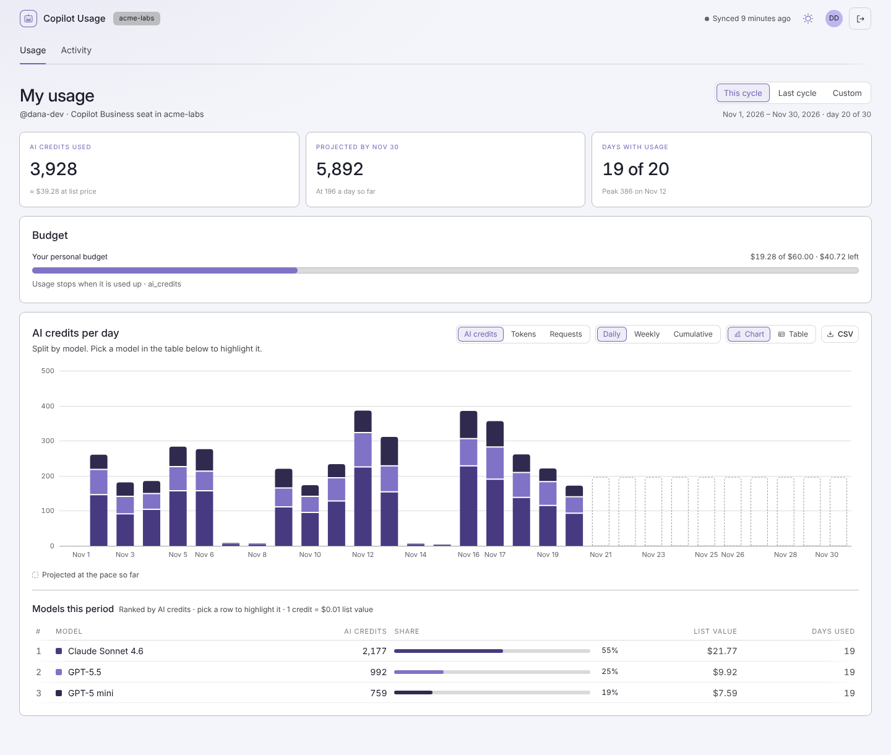
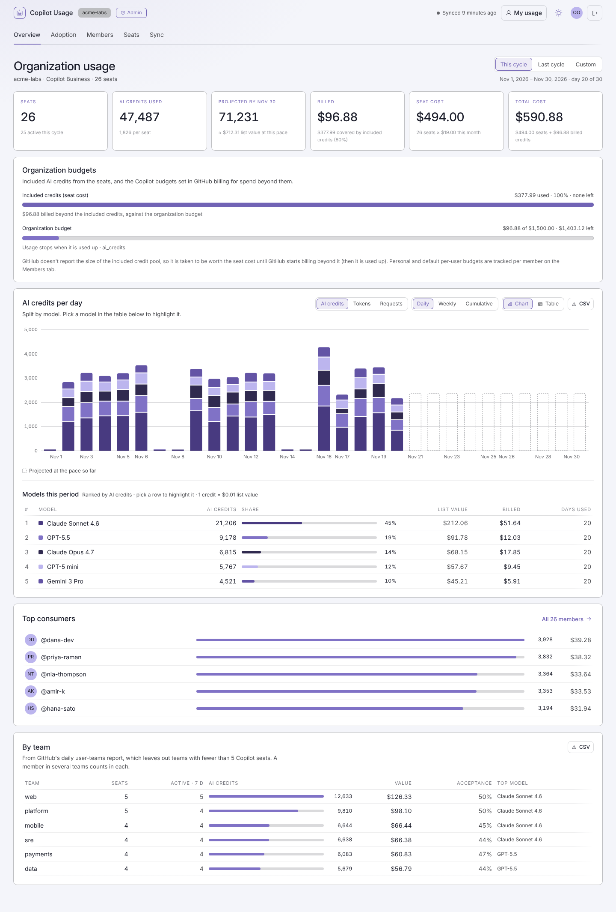
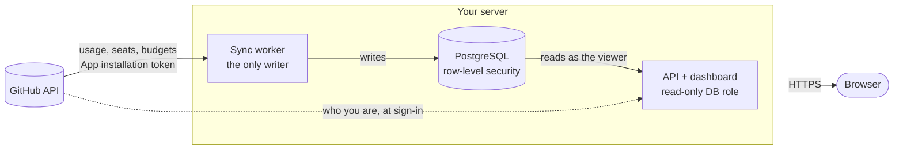

# copilot-user-metrics

**A self-hosted GitHub Copilot usage dashboard for every seat holder in your organization, not
only for org owners.**

GitHub shows an organization's Copilot usage (AI credits, models, budgets, activity) to org
owners only. Developers with a Copilot seat can't see how many credits they used, which models
they used them on, or how close they are to their budget. This app closes that gap: a sync
worker reads the usage from GitHub as the organization's GitHub App and stores it per person,
day and model. Everyone signs in with GitHub and sees their own numbers. Admins and readers you
choose also see the whole organization.

<picture>
  <source media="(prefers-color-scheme: dark)" srcset="docs/images/my-usage-dark.png">
  
</picture>

## Quickstart

You need a host with Docker Compose, a GitHub organization with Copilot Business, and an org
owner who can install a GitHub App.

1. **Create a GitHub App** in your organization (*Settings → Developer settings → GitHub Apps
   → New GitHub App*):
   - Callback URL: `http://localhost:8000/auth/github/callback`.
   - Webhook: turned off.
   - Organization permissions, all read-only: *Administration*, *GitHub Copilot Business*,
     *Organization Copilot metrics*, *Members*.

   Then generate a client secret and a private key, and install the App on the organization.
   Details: [step 1 of the deployment guide](docs/deployment/docker-compose.md#1-create-the-github-app).
2. **Get the stack:** make a folder for it:

   ```bash
   mkdir -p copilot-usage/db copilot-usage/secrets && cd copilot-usage
   ```

   Copy these four files from [`deploy/`](deploy/) on GitHub into it, keeping the paths:

   | File | What it is |
   | --- | --- |
   | [`compose.yaml`](deploy/compose.yaml) | the stack |
   | [`.env.example`](deploy/.env.example) | the settings, documented |
   | [`db/entrypoint.sh`](deploy/db/entrypoint.sh) | sets up the app's database roles |
   | [`db/setup.sql`](deploy/db/setup.sql) | the same, in SQL |

   (Or clone the repository and work in its `deploy/` folder.) The stack pulls the prebuilt
   image from GHCR, so nothing gets built from source. While the package is private, run
   `docker login ghcr.io` first with a token that has `read:packages`.
3. **Configure it:**

   ```bash
   cp .env.example .env              # set GITHUB_ORG and the App's ID, client ID and client secret
   cp ~/Downloads/<app>.private-key.pem secrets/github-app.pem
   chmod 644 secrets/github-app.pem  # the app runs as a non-root user that must read it
   # one secret each for SESSION_SECRET, POSTGRES_PASSWORD, OWNER_DB_PASSWORD, API_DB_PASSWORD, WORKER_DB_PASSWORD:
   python3 -c "import secrets; print(secrets.token_hex(32))"
   ```

4. **Start it:**

   ```bash
   docker compose up -d
   ```

5. Open http://localhost:8000 and sign in with GitHub. On its first start the worker loads all
   the history GitHub still keeps, newest days first, so the numbers fill in over the following
   minutes to hours.

This runs on plain HTTP on `localhost`, which is fine for a first look. For a real deployment
behind HTTPS, follow the **[Docker Compose deployment guide](docs/deployment/docker-compose.md)**.

## What you get

What each person sees depends on their role, which is worked out when they sign in:

| Role | Who | Sees |
| --- | --- | --- |
| **Member** | Every org member with a Copilot seat | **Usage**: their AI credits over time, per model and per kind of call, gross / included / billed amounts, and their budget. **Activity**: their Copilot activity (code completions, chat, agents, skills, models). CSV download. |
| **Organization reader** | Members of the teams in `ACCESS_ORG_READER_TEAMS` | Everything an admin sees, read-only, without the Sync page. |
| **Admin** | Org owners, plus members of the teams in `ACCESS_ADMIN_TEAMS` | The admin console: **Overview** (org credits, budgets, top consumers), **Adoption** (active users, pull requests and agents, skills, per team), **Members** (everyone's usage, with a page per person), **Seats** (seat assignments and cost), and **Sync** (data freshness, run or stop a sync). |

People who are signed in but have no seat (or aren't org members) get a page explaining why
they see nothing.

<details>
<summary>The admin console's Overview (screenshot)</summary>

<picture>
  <source media="(prefers-color-scheme: dark)" srcset="docs/images/admin-overview-dark.png">
  
</picture>

</details>

Every page, with screenshots and what it shows: the **[user guide](docs/user-guide.md)**.

## What it is not

- **Not multi-org or enterprise-wide.** One deployment serves one GitHub organization.
- **Not a billing system.** Every credit, dollar amount, budget and seat cost comes from GitHub
  as GitHub reports it. The app computes nothing of its own. GitHub's billing stays the source
  of truth.
- **Not real time.** Credits refresh every 20 minutes, seats and budgets every hour, and
  activity metrics once a day (GitHub publishes those a day late). The dashboard warns when
  the data is behind.
- **Not a management tool.** It only reads from GitHub. It can't assign seats, change budgets
  or change policies.
- **Not a hosted service.** You run it yourself: one container image plus Postgres.

## How it works



- **Sync worker**: authenticates as the GitHub App and pulls seats, AI credit usage, budgets
  and usage metrics on a schedule. On start it fills in any days that are missing, up to
  GitHub's retention (about 24 months of credits and 12 months of metrics).
- **API**: serves the dashboard and a JSON API. GitHub sign-in is used only to find out who you
  are and your role. Every query runs as a read-only database role under row-level security, so
  a member can only ever read their own rows.
- **One image** (`ghcr.io/insanedwayne/copilot-user-metrics`) runs every part:
  `copilot-metrics api | worker | migrate | backfill | healthcheck`.

More: [Architecture](docs/architecture.md) · [Security model](docs/security.md)

## Repository layout

```
backend/        Python 3.14: FastAPI API, procrastinate sync worker, Alembic migrations, tests
frontend/       React 19 + Vite + TypeScript dashboard (built into the image, served by the API)
deploy/         Docker Compose stacks to deploy with
ci/             CI test stack and image smoke test
tools/          Screenshot generator for the docs (Playwright + demo data)
docs/           Documentation (see below)
Dockerfile      One image for all parts; also the CI test targets
justfile        Developer tasks (`just` lists them)
.devcontainer/  Dev container with Postgres for local development
```

## Documentation

**Running it**
- [Docker Compose deployment](docs/deployment/docker-compose.md): GitHub App, `.env`, first start,
  HTTPS, checking that it works.
- [Operations](docs/operations.md): upgrades, downgrades, backups, re-syncing, health checks,
  troubleshooting.
- [Configuration reference](docs/configuration.md): every setting, with its default.
- [Branding](docs/branding.md): your name, logo, fonts and colours, without a rebuild.

**Using it**
- [User guide](docs/user-guide.md): every page, by role, with screenshots.

**Understanding it**
- [Architecture](docs/architecture.md): components, data flow, sync jobs, data sources.
- [Security model](docs/security.md): roles, database roles, row-level security, sessions, secrets.
- [Security policy](SECURITY.md): how to report a vulnerability.

**Working on it**
- [Contributing](CONTRIBUTING.md): issues, pull requests, what maintainers do.
- [Development](docs/development.md): dev container, `just` recipes, tests, code conventions.
- [Backend](backend/README.md): module layout and rules.
- [CI and releasing](docs/releasing.md): checks, image publishing, versioning.
- [Screenshots](tools/screenshots/README.md): how the docs' screenshots are generated, and how a release checks they're current.

## License

[MIT](LICENSE)
