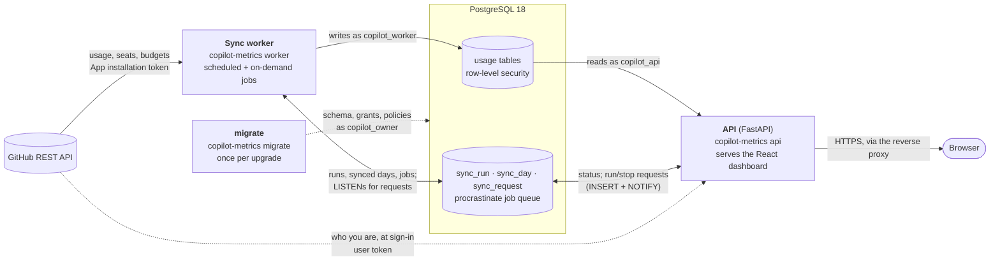
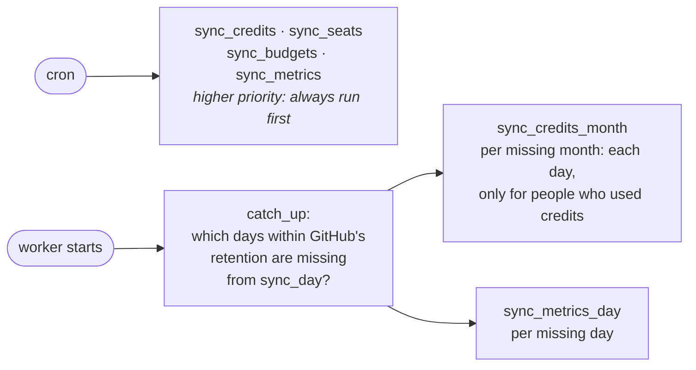
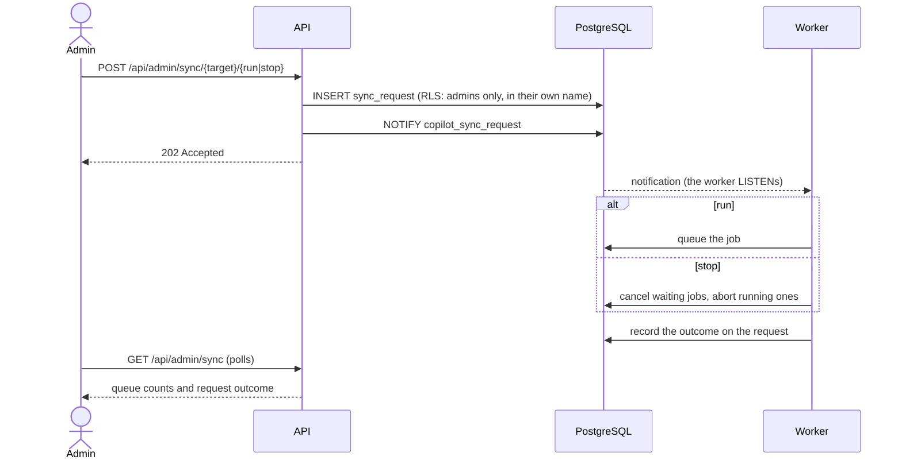

# Architecture

## Components



| Part | Tech | Entry point |
| --- | --- | --- |
| API | FastAPI, pydantic-settings, SQLAlchemy Core (async, psycopg 3) | [`api.py`](../backend/src/copilot_metrics/api.py) |
| Sync worker | procrastinate (Postgres-backed jobs and cron), httpx, PyJWT | [`worker.py`](../backend/src/copilot_metrics/worker.py) |
| Database | PostgreSQL 18, Alembic migrations, row-level security | [`backend/migrations/`](../backend/migrations/) |
| Frontend | React 19, Vite, TypeScript, Tailwind CSS 4, TanStack Query, React Router, zod | [`frontend/`](../frontend/) |

One image runs every part through the `copilot-metrics` CLI
([`cli.py`](../backend/src/copilot_metrics/cli.py)):

| Command | What it does |
| --- | --- |
| `api [--host] [--port]` | the API, serving the dashboard when `API_STATIC_DIR` is set |
| `worker` | the sync worker: scheduled jobs, catch-up on start, admin run/stop requests |
| `migrate [revision]` | Alembic upgrade (default `head`) or downgrade to a revision, as the owner role |
| `backfill [--credits-days N] [--metrics-days N]` | queues a re-fetch of all history, synced or not |
| `healthcheck` | exits 1 unless the worker in this container is alive and no job keeps failing |

There is no message broker and no cache: Postgres is the only state, including the job queue.

## Data flow

The worker is the only process that talks to GitHub with the App's identity and the only
writer. The API only reads, so the dashboard keeps working when GitHub or the worker is down,
showing the last synced numbers with a "may be behind" banner.

### Data sources

| GitHub endpoint | Synced into | Job |
| --- | --- | --- |
| `GET /orgs/{org}/copilot/billing/seats`, `/copilot/billing` | `seat`, `org_seat_summary` | `sync_seats` |
| `GET /organizations/{org}/settings/billing/usage/summary` | `org_seat_cost` | `sync_seats` |
| `GET /organizations/{org}/settings/billing/ai_credit/usage` (per seat holder, per day) | `credit_usage`, `org_credit_day` | `sync_credits`, `sync_credits_month` |
| `GET /organizations/{org}/settings/billing/budgets` (org-wide and per seat holder) | `org_budget`, `user_budget` | `sync_budgets` |
| `GET /orgs/{org}/copilot/metrics/reports/{report}` (daily reports) | `user_activity`, `org_activity_day`, `user_team_day` | `sync_metrics`, `sync_metrics_day` |

At sign-in the API uses the user's token for `GET /user`, `GET /user/memberships/orgs/{org}`
and, if teams are configured, `GET /orgs/{org}/teams/{slug}/memberships/{login}`.

No number is computed from local prices: credits, dollar amounts (gross, included, billed),
budgets and seat cost are what GitHub reports. GitHub's API doesn't expose included credits per
seat, so the dashboard shows included against billed rather than a pool size.

### Sync jobs

| Job | When | Notes |
| --- | --- | --- |
| `sync_credits` | `SYNC_CREDITS_CRON` (20 min) | the last `SYNC_CREDITS_LOOKBACK_DAYS` (2) days |
| `sync_seats` | `SYNC_SEATS_CRON` (hourly) | seats first, so the per-person calls know whom to ask |
| `sync_budgets` | `SYNC_BUDGETS_CRON` (hourly) | |
| `sync_metrics` | `SYNC_METRICS_CRON` (daily) | the last `SYNC_METRICS_LOOKBACK_DAYS` (3) days |
| `catch_up` | worker start | queues every day within GitHub's retention that `sync_day` doesn't have yet |
| `backfill` | `copilot-metrics backfill` | like `catch_up`, but every day |
| `sync_credits_month`, `sync_metrics_day` | queued by `catch_up` / `backfill` | history jobs, retried with linear backoff |
| `recover_stalled_jobs` | every 5 min | re-queues jobs a crashed or stopped worker left running |
| `prune_history` | daily | drops old sync runs, handled requests, finished queue jobs |



- **History goes a month at a time.** One call per seat holder for the month finds who used
  credits, and only those people are asked about each day, in parallel
  (`SYNC_PARALLEL_REQUESTS`).
- **Priorities.** History jobs queue below the periodic ones, so a long first load never delays
  current numbers. Newest days go first.
- **Queueing locks** keep a periodic job from piling up when a run takes longer than its
  interval.
- **Bookkeeping.** `sync_run` records every run, and `sync_day` records which days are synced.
  The Sync page and the staleness banner read these.
- **Health.** The worker writes a heartbeat file that `copilot-metrics healthcheck` reads. It
  includes jobs that have failed `SYNC_ALERT_AFTER_FAILURES` times since their last success.

### Run/stop from the dashboard

The API never touches the job queue. An admin's click becomes a row the worker picks up:



See also [Security model](security.md#database).

## Backend layout

A modular monolith. Each module (`identity`, `usage`, `sync`, plus `shared`) is a hexagon:

```
<module>/
  domain.py   ports.py   service.py          # core: no FastAPI, SQL or httpx
                                             # (usage/ and sync/ have a domain/ package, one file per area)
  adapters/
    inbound/                                 # drive the core
      http/router.py                         # FastAPI routes
      http/dependencies.py                   # FastAPI dependencies (identity guards)
      http/middleware.py  http/error_handlers.py  http/spa.py   # shared only
      jobs/tasks.py                          # procrastinate tasks (sync)
    outbound/                                # implement the ports
      postgres/repository.py                 # or seat_directory.py; shared: engine.py, tables.py
                                             # (usage: SQL in queries.py, breakdowns.py)
      github/org_client.py                   # or identity_provider.py; shared: http_client.py
```

| Module | Responsibility |
| --- | --- |
| `identity` | sign-in (GitHub App user authorization), roles, session guards |
| `usage` | read side: `/api/me`, `/api`, `/api/admin` |
| `sync` | write side: GitHub App client, upserts, scheduled tasks, sync control |
| `shared` | kernel (`Period`, `Viewer`, `Role`), tables, database engine (RLS scope), GitHub HTTP basics, errors |

`api.py` and `worker.py` are the composition roots that wire adapters to services. Module
rules are in [`backend/README.md`](../backend/README.md).

### HTTP API

| Prefix | Who | What |
| --- | --- | --- |
| `/auth/github`, `/auth/github/callback`, `/auth/logout` | anyone | sign-in and sign-out |
| `/api/session`, `/api/config` | anyone | the current session and role, public config (org name, session length) |
| `/api/me/*` | seat holders | your own usage and activity, no login parameter |
| `/api/sync/status` | signed-in org members | data freshness, for the "may be behind" banner |
| `/api/org/summary` | admins, organization readers | org totals, seat cost, org budgets |
| `/api/admin/*` | admins, organization readers | org usage, members, seats, teams, adoption |
| `/api/admin/sync/*` | admins | sync status, run and stop |
| `/healthz` | anyone | liveness and database reachability |

Everything else serves the dashboard (client-side routes included).

### Errors

Modules raise domain errors ([`shared/errors.py`](../backend/src/copilot_metrics/shared/errors.py):
`NotAuthenticated`, `AccessDenied`, `NotFound`, `InvalidRequest`, subclassed per module, e.g.
`SessionExpired`, `MemberNotFound`, `InvalidPeriod`). No route raises `HTTPException`. One
handler (`shared/adapters/inbound/http/error_handlers.py`, table `_STATUS_BY_CATEGORY`) maps each
category to 401/403/404/422 and answers every error, including request validation, unknown
routes and bugs (500), as `{"code": "...", "detail": "..."}`. The SPA reads both into
`ApiError`.

## Frontend layout

```
frontend/src/
  app/            router, layout, home redirect
  features/       one folder per feature: api/ hooks/ components/ pages/ utils/ + index.ts
    session/      sign-in, access guards, no-access page
    usage/        personal Usage and Activity pages
    admin/        admin console (lazy-loaded)
    sync-status/  freshness banner, Sync page
    org-summary/  app-config/
  shared/         api client, ui building blocks, charts, theme, utils
  config/         env and theme.json parsing
```

Features import each other only through their `index.ts`. Styling and theming conventions are
in [Development](development.md#frontend-conventions).

## Database

Alembic revisions in [`backend/migrations/versions/`](../backend/migrations/versions/) create
the schema, the grants for the API and worker roles, the RLS policies and the procrastinate
queue. Procrastinate upgrades come in as new Alembic revisions with the SQL from
`procrastinate/sql/migrations`.
