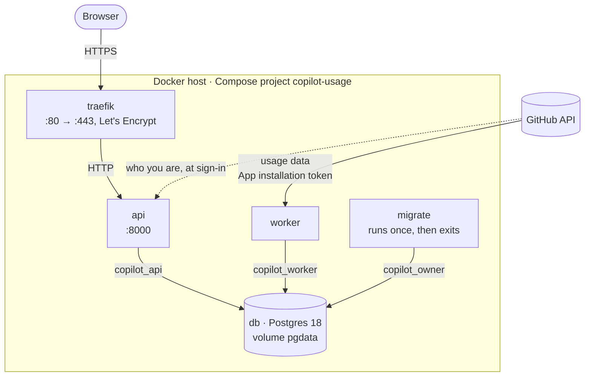

# Deploying with Docker Compose

This guide sets up copilot-user-metrics on one host with Docker Compose. It ends with the
dashboard running behind HTTPS. Plan for about 30 minutes, plus the time the first history
load takes.

The app ships as **one container image**, `ghcr.io/insanedwayne/copilot-user-metrics`. The API
also serves the dashboard, so a deployment is that image plus Postgres:

| Service | What it does |
| --- | --- |
| `db` | Postgres 18. On every start, before it accepts connections, it creates the app's three database roles and sets their passwords from `.env`. |
| `migrate` | Runs once: applies the database migrations, then exits. `api` and `worker` start only after it has succeeded. |
| `api` | The API and the dashboard, on port 8000. |
| `worker` | The sync worker: pulls usage from GitHub on a schedule. |

With the reverse proxy from [step 6](#6-put-it-behind-https), the finished deployment looks like
this:



**Contents**

1. [Create the GitHub App](#1-create-the-github-app)
2. [Get the stack](#2-get-the-stack)
3. [Configure `.env`](#3-configure-env)
4. [Start it](#4-start-it)
5. [Check that it works](#5-check-that-it-works)
6. [Put it behind HTTPS](#6-put-it-behind-https)
7. [Give people access](#7-give-people-access)

Afterwards: [Operations](../operations.md) (upgrades, backups, troubleshooting) and the
[Configuration reference](../configuration.md).

## Prerequisites

- A Linux host (amd64 or arm64) with **Docker Engine** and the **Docker Compose plugin** (v2.17
  or newer: the `db` service uses an inline Dockerfile).
- A GitHub organization with **Copilot Business** (or Enterprise) seats.
- An **org owner** who can install the GitHub App and who has enabled the *Copilot usage
  metrics* policy for the organization (*Settings → Copilot → Policies*). Without that policy
  GitHub returns no activity metrics.
- For production, a DNS name for the dashboard (e.g. `copilot.example.com`) pointing at the
  host, with ports 80 and 443 reachable for the TLS certificate.

## 1. Create the GitHub App

The app uses one GitHub App for two things. The **worker** reads org usage with the App's
installation token. The **API** signs people in through the App's user authorization and only
reads who they are.

1. Go to *Organization settings → Developer settings → GitHub Apps → New GitHub App*. Creating
   the App under the organization, not under a personal account, keeps it independent of any
   one person.
2. Fill in:

   | Field | Value |
   | --- | --- |
   | GitHub App name | anything, e.g. `Acme Copilot Usage` (people see it when they sign in) |
   | Homepage URL | your dashboard URL, e.g. `https://copilot.example.com` |
   | Callback URL | `<PUBLIC_URL>/auth/github/callback`, e.g. `https://copilot.example.com/auth/github/callback`. To try it on your machine first: `http://localhost:8000/auth/github/callback` (you can add both). |
   | Webhook | untick **Active**: the app needs no webhooks |
   | Where can this GitHub App be installed? | **Only on this account** |

3. Under **Permissions → Organization permissions** set these to **Read-only**. Leave everything
   else at *No access*:

   | Permission | Used for |
   | --- | --- |
   | Administration | billing: AI credit usage, budgets, seat cost |
   | GitHub Copilot Business | Copilot seats |
   | Organization Copilot metrics | activity metrics (completions, chat, agents, models) |
   | Members | org and team membership at sign-in |

4. Click **Create GitHub App**. On the App's page:
   - note the **App ID** and the **Client ID**;
   - **Generate a new client secret** and copy it (it's shown once);
   - **Generate a private key**: your browser downloads a `.pem` file.
5. **Install App** (left menu) → install it on your organization.

## 2. Get the stack

The stack is four files from the [`deploy/`](../../deploy/) folder of this repository. It
pulls the prebuilt image from GHCR, so the host builds nothing except the small `db` image.
Make a folder for it and copy the files from GitHub into it, keeping the paths:

```bash
mkdir -p copilot-usage/db copilot-usage/secrets && cd copilot-usage
```

```text
copilot-usage/
├── compose.yaml        # the stack: deploy/compose.yaml
├── .env.example        # copy to .env: deploy/.env.example
├── db/
│   ├── entrypoint.sh   # Postgres role setup: deploy/db/entrypoint.sh
│   └── setup.sql       # deploy/db/setup.sql
└── secrets/            # put the GitHub App private key here
```

For a production host, copy the files from the tag of the release you run (switch the branch
selector on GitHub to e.g. `v1.4.0`), so they match the image version. Also pin that version
in `.env` ([step 3](#3-configure-env)). With `APP_VERSION` empty the stack runs the `latest` image.

You can also clone the repository and work in `deploy/`, which has the same files plus the
[alternative stack](#which-stack) and the [build overrides](#building-from-source).

> While the GHCR package is private, the host needs `docker login ghcr.io` first, with a
> token that has `read:packages`.

### Which stack?

| | `compose.yaml` (default) | `compose.worker-migrates.yaml` |
| --- | --- | --- |
| Migrations | a one-shot `migrate` container | the worker, before it starts syncing |
| Containers | 4 | 3 |
| During an upgrade | the API waits until migrations are done | the API may return errors for the few seconds a migration takes |
| Owner DB password | only the `migrate` container has it | the worker has it |

Use the default unless one container fewer matters to you. To use the alternative, copy
[`deploy/compose.worker-migrates.yaml`](../../deploy/compose.worker-migrates.yaml) next to
`compose.yaml` and set
`COMPOSE_FILE=compose.worker-migrates.yaml` in `.env`, or pass `-f` to every command. Both
stacks share the `.env`, the database volume and the project name, so you can switch later
with `docker compose up -d --remove-orphans`.

## 3. Configure `.env`

```bash
cp .env.example .env
cp ~/Downloads/<app-name>.<date>.private-key.pem secrets/github-app.pem
chmod 644 secrets/github-app.pem
```

The containers run as an unprivileged user (uid 10001), and Compose mounts the key file with
its host permissions, so it must be readable by others. Protect it by restricting access to the
directory instead, e.g. `chmod 700` on the stack's folder.

Generate five secrets: the session secret and four database passwords. Use hex, so the
passwords are safe inside connection URLs:

```bash
for v in SESSION_SECRET POSTGRES_PASSWORD OWNER_DB_PASSWORD API_DB_PASSWORD WORKER_DB_PASSWORD; do
  echo "$v=$(python3 -c 'import secrets; print(secrets.token_hex(32))')"
done
```

(No Python? `openssl rand -hex 32` does the same.) Then edit `.env`:

```dotenv
GITHUB_ORG=acme-labs                         # the org's login, as in github.com/acme-labs
GITHUB_APP_ID=123456
GITHUB_APP_CLIENT_ID=Iv23li...
GITHUB_APP_CLIENT_SECRET=...

PUBLIC_URL=https://copilot.example.com       # or http://localhost:8000 to try it out
SESSION_SECRET=<generated>

POSTGRES_PASSWORD=<generated>
OWNER_DB_PASSWORD=<generated>
API_DB_PASSWORD=<generated>
WORKER_DB_PASSWORD=<generated>
```

Optional settings you may want now:

- `APP_VERSION`: the release to run, e.g. `1.4.0`. Empty means `latest`. Pin it in production, so upgrades and their migrations only happen when
  you decide.
- `ACCESS_ADMIN_TEAMS` / `ACCESS_ORG_READER_TEAMS`: see [step 7](#7-give-people-access).

Everything else has sensible defaults: see the [Configuration reference](../configuration.md).
The commented [`.env.example`](../../deploy/.env.example) lists them too.

## 4. Start it

```bash
docker compose up -d
docker compose ps
```

The first `up` builds the small `db` image locally (from `postgres:18`) and pulls the app
image. After a minute `db`, `api` and `worker` should show as running (healthy), and `migrate`
as exited with code 0.

On its **first start the worker loads all the history GitHub still keeps**: up to 24 months of
AI credits and 12 months of activity metrics, newest days first. The dashboard fills in while
it runs. Depending on the size of the org this takes minutes to a few hours. Regular syncs go
ahead of the history jobs, so current numbers are fresh from the start. Later starts only fill
in gaps, such as days the worker was down.

## 5. Check that it works

```bash
curl -fsS http://127.0.0.1:8000/healthz        # "ok": the API is up and can reach the database
docker compose exec worker copilot-metrics healthcheck   # "ok": the worker is alive and no job keeps failing
docker compose logs -f worker                  # watch the first sync
```

Then open `PUBLIC_URL` and sign in:

- As an **org owner** you land on the admin console (on **Usage** if you also have a seat;
  **Admin console** in the header switches). **Admin console → Sync** shows when each
  kind of data last synced, how much history is still queued, and any failures.
- As a **seat holder** you land on **Usage**. A seat assigned in the last hour appears after
  the next seat sync.

What each page shows: the [user guide](../user-guide.md).

If something is off, see [Troubleshooting](../operations.md#troubleshooting).

## 6. Put it behind HTTPS

The API speaks plain HTTP and leaves TLS to a reverse proxy in front of it. It refuses to start
with an `http://` `PUBLIC_URL` unless the host is `localhost`. With an `https://` `PUBLIC_URL`
the session cookie gets the `Secure` flag.

### Traefik in the same stack

[Traefik](https://doc.traefik.io/traefik/) runs as one more container in the stack, routes
`https://copilot.example.com` to the `api` container, and gets and renews a Let's Encrypt
certificate by itself. Ports 80 and 443 of the host must be free and reachable from the
internet, since Let's Encrypt checks the name over port 80.

Next to `compose.yaml`, create a `compose.override.yaml`. Docker Compose reads it automatically,
and it isn't one of the files you copy from the repository, so it survives upgrades. Replace the host name and the
e-mail address (Let's Encrypt sends expiry warnings there):

```yaml
services:
  traefik:
    image: traefik:v3
    restart: unless-stopped
    security_opt: ["no-new-privileges:true"]
    command:
      - --providers.docker=true
      - --providers.docker.exposedbydefault=false # only containers with traefik.enable=true
      - --entrypoints.web.address=:80
      - --entrypoints.web.http.redirections.entrypoint.to=websecure
      - --entrypoints.web.http.redirections.entrypoint.scheme=https
      - --entrypoints.websecure.address=:443
      - --certificatesresolvers.letsencrypt.acme.email=admin@example.com
      - --certificatesresolvers.letsencrypt.acme.storage=/letsencrypt/acme.json
      - --certificatesresolvers.letsencrypt.acme.httpchallenge.entrypoint=web
    ports:
      - "80:80"
      - "443:443"
    volumes:
      - /var/run/docker.sock:/var/run/docker.sock:ro
      - letsencrypt:/letsencrypt

  api:
    labels:
      - traefik.enable=true
      - traefik.http.routers.copilot.rule=Host(`copilot.example.com`)
      - traefik.http.routers.copilot.entrypoints=websecure
      - traefik.http.routers.copilot.tls.certresolver=letsencrypt
      - traefik.http.services.copilot.loadbalancer.server.port=8000

volumes:
  letsencrypt:
```

Set `PUBLIC_URL=https://copilot.example.com` in `.env`, make sure the GitHub App's callback URL
is `https://copilot.example.com/auth/github/callback`, and apply:

```bash
docker compose up -d
docker compose logs -f traefik    # the certificate arrives within a minute
```

Plain-HTTP requests on port 80 are redirected to HTTPS. Traefik's own dashboard stays off.

> **The Docker socket.** Traefik reads the `traefik.*` labels through the Docker API, so it gets
> the Docker socket. `:ro` doesn't limit what can be done through the API, so whoever takes
> over the Traefik container controls Docker on the host. If that's too much, put a
> read-only Docker socket proxy in between, or use Traefik's
> [file provider](https://doc.traefik.io/traefik/providers/file/) with a static route to
> `http://api:8000` instead of labels.

> **With `COMPOSE_FILE` in `.env`** (to pick the worker-migrates stack), list the override as
> well: `COMPOSE_FILE=compose.worker-migrates.yaml:compose.override.yaml`. Compose reads
> `compose.override.yaml` by itself only when no files are given.

The API stays published on `127.0.0.1:8000` as well, which is handy for `curl` checks on the
host and unreachable from outside.

### A proxy you already have

Caddy, nginx, a load balancer, or a Traefik you already run: point it at `http://<host>:8000`, and pass
the original `Host` header through. If the proxy
runs on the same host, the default `APP_BIND=127.0.0.1` is right. If it runs on another
machine, set `APP_BIND=0.0.0.0` and firewall port 8000 so only the proxy can reach it. nginx:

```nginx
server {
    listen 443 ssl;
    server_name copilot.example.com;
    # ssl_certificate / ssl_certificate_key ...

    location / {
        proxy_pass http://127.0.0.1:8000;
        proxy_set_header Host $host;
        proxy_set_header X-Forwarded-For $proxy_add_x_forwarded_for;
        proxy_set_header X-Forwarded-Proto $scheme;
    }
}
```

Sign-in builds its redirect URL from `PUBLIC_URL`, not from request headers, so forwarded
headers only affect which client address shows up in the API's logs (see
`FORWARDED_ALLOW_IPS` in the [Configuration reference](../configuration.md#api)).

### No TLS at all (test hosts only)

To run on plain HTTP under a name other than `localhost`, set `ALLOW_HTTP=true`. The session
cookie and the OAuth code then cross the network unencrypted, so never do this in production.

## 7. Give people access

| Role | Who gets it |
| --- | --- |
| Member: own usage | every active org member with a Copilot seat, automatically |
| Organization reader: all org data, read-only | members of the teams in `ACCESS_ORG_READER_TEAMS` |
| Admin: all org data plus the Sync page | org owners, always, plus members of the teams in `ACCESS_ADMIN_TEAMS` |

Both settings are comma-separated **team slugs** of `GITHUB_ORG`: the part after
`/orgs/<org>/teams/` in the team's URL. Members of child teams count too:

```dotenv
ACCESS_ADMIN_TEAMS=copilot-app-admins
ACCESS_ORG_READER_TEAMS=engineering-managers,finance
```

Run `docker compose up -d` to apply changes. Roles are checked with GitHub at sign-in, so a
change reaches a person at their next sign-in, at the latest after 4 hours, when sessions expire
(`SESSION_MAX_AGE_HOURS`).

> **Security:** a slug only names a team. Whoever maintains that team decides who gets the role.
> If the team is renamed or deleted, or the slug is misspelled, anyone allowed to create teams
> can create one with that slug and take the role. Check the slugs against existing teams, and
> turn off team creation by members in the org's *Member privileges*. More in the
> [Security model](../security.md#roles).

## Building from source

To run code that isn't released yet, add the build override of the stack you use. It builds the
image from the checkout and tags it `copilot-usage:local`:

```bash
docker compose -f deploy/compose.yaml -f deploy/compose.build.yaml up -d --build
# or
docker compose -f deploy/compose.worker-migrates.yaml -f deploy/compose.worker-migrates.build.yaml up -d --build
```

## Hardening already in place

- Every container runs with a read-only root filesystem, `cap_drop: [ALL]` and
  `no-new-privileges`. Postgres gets back only the capabilities its entrypoint needs to hand the
  data directory to the `postgres` user.
- No app container connects as the Postgres superuser. Migrations run as an owner role, the
  worker as the only writer, and the API as a read-only role under row-level security.
- Each container gets only the secrets it needs. The App private key is mounted into the worker
  only, as a Compose secret. The session and OAuth secrets go to the API only.

## Next steps

- [Operations](../operations.md): upgrades, backups, re-syncing, troubleshooting.
- [Branding](../branding.md): your logo, name and colours.
- [Configuration reference](../configuration.md): schedules, retention, session length.
