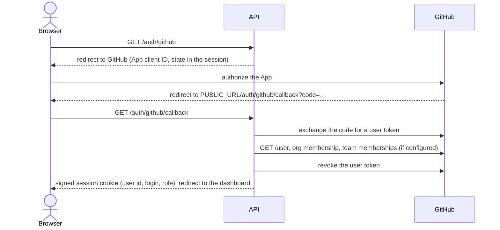
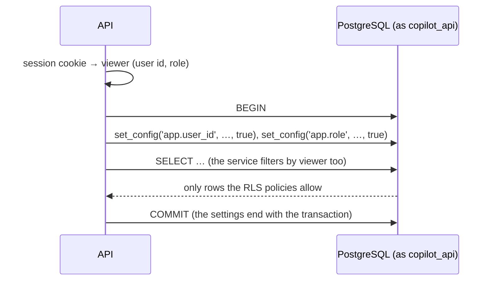

# Security model

The app holds per-person Copilot usage of a whole organization, but GitHub only lets org owners
read it. The security model makes sure that granting everyone a dashboard doesn't grant everyone
everyone's data.

## In short

- Members only ever read their own rows, enforced in the API **and** by Postgres row-level
  security.
- Nothing is ever written to GitHub. The app only reads.
- Each process gets the least privilege it needs, in GitHub, in Postgres and in Docker.

## Roles

Each person's role is worked out once, at sign-in, from GitHub:

| Role | Who | Can see |
| --- | --- | --- |
| **admin** | org owners, plus members of a team in `ACCESS_ADMIN_TEAMS` | the whole admin console, including the Sync page (run or stop syncs). Whoever runs the app doesn't need to be an org owner. |
| **org_reader** (organization reader) | members of a team in `ACCESS_ORG_READER_TEAMS` | the admin console read-only, without the Sync page. No GitHub org role needed. |
| **member** | every other active org member | only their own usage, and only if they have a Copilot seat |
| outsider | signed in, but not an active org member | nothing |

- Both team lists are comma-separated team slugs of `GITHUB_ORG`, empty by default. Members of
  child teams count. Only active org members get a role, so pending invitations don't count. If
  someone is in both lists, admin wins.
- **A slug only names a team.** The team's maintainers decide who gets the role. A slug whose
  team was renamed, deleted or misspelled can be claimed by anyone allowed to create teams. Keep
  the slugs pointing at existing teams, and turn off team creation by members in the org's
  *Member privileges*.
- Roles are only checked at sign-in, so the session lifetime (`SESSION_MAX_AGE_HOURS`, 4 h)
  bounds how long a removed admin keeps access.

## Sign-in and sessions

- Sign-in uses the GitHub App's user authorization (OAuth). The user token is used for `/user`,
  the org membership check and, only if teams are configured, the team membership checks. Then
  it is revoked. It is never stored.
- The session cookie is http-only, `SameSite=Lax`, signed with `SESSION_SECRET` (at least 32
  characters), and `Secure` when `PUBLIC_URL` is https. It holds the user id, login and role,
  and expires after `SESSION_MAX_AGE_HOURS`.
- The API refuses to start with a plain-HTTP `PUBLIC_URL` on any host but `localhost`, unless
  `ALLOW_HTTP=true` is set explicitly.
- The interactive API docs (`/docs`, `/openapi.json`) are off unless `API_DOCS=true`, which is
  meant for development. The compose files never set it.

## Database

Three login roles, none of them a superuser and none able to bypass row-level security:

| Role | Used by | Can |
| --- | --- | --- |
| `copilot_owner` | `migrate` | run migrations, own the tables, grant to the other two |
| `copilot_worker` | the sync worker | write the usage tables, run the job queue. The only writer. |
| `copilot_api` | the API | read, plus insert sync requests. Subject to row-level security. |

In the Compose stack no app container connects as the Postgres superuser: the `db` container
creates these roles itself ([`deploy/db/setup.sql`](../deploy/db/setup.sql)), and table grants
and policies come from the migrations.

**Row-level security.** Every API request runs in a transaction with `app.user_id` and
`app.role` set from the session. RLS policies return only the viewer's rows unless the viewer is
an admin or organization reader.

- The service layer filters explicitly as well, so for the per-person tables and `sync_request`, RLS is the second line of defence.
- The org-level aggregates (`org_*`) and the sync status tables (`sync_run`, `sync_day`, the job
  queue) have no policies. For them the API's role guards are the only check.
- `/api/me/*` takes no login parameter. Only `/api/admin/members/{login}/*` names a person, and
  it requires an admin or organization reader.

**Sync control.** Admins can run or stop a sync from the Sync page, but the API never touches
the job queue. It inserts a `sync_request` row (RLS: admins only, in their own name), reads queue
counts, and wakes the worker with `NOTIFY copilot_sync_request`. The worker applies the request
(queue the job, or cancel waiting jobs and abort running ones) and records the outcome.

## GitHub App

- Read-only permissions only: *Administration*, *GitHub Copilot Business*, *Organization
  Copilot metrics*, *Members*. No webhooks.
- The private key is only read by the worker. In Compose it is a secret mounted into the worker
  container only. The API never calls billing endpoints.

## Containers

- Read-only root filesystems, `cap_drop: [ALL]`, `no-new-privileges`. Postgres gets back only
  the capabilities its entrypoint needs to hand the data directory to the `postgres` user.
- The app runs as an unprivileged user (uid 10001).
- The API is published on `127.0.0.1` by default, for a TLS-terminating reverse proxy on the
  same host.
- Each container receives only its own secrets: the App key goes to the worker, the session and
  OAuth secrets to the API, and the owner password to `migrate` (or to the worker in the
  worker-migrates stack).

## Deliberately not included

- **Audit logging of admin reads.** Admins and organization readers can see the same numbers in
  GitHub, and the app only reads, so reads are not recorded.

## Supply chain

- Lockfiles are audited on every PR, on `main`, and weekly (`pip-audit`, `npm audit`), and
  Dependabot proposes updates. See [CI and releasing](releasing.md).
- Release images carry an SBOM and BuildKit provenance, plus a signed GitHub build-provenance
  attestation.
- Releases wait for a maintainer's approval in the `release` environment, and only commits on
  a protected `main` can be released. See
  [One-time repository setup](releasing.md#one-time-repository-setup).

To report a vulnerability, see [`SECURITY.md`](../SECURITY.md).
