# User guide

What people see in the dashboard, page by page: signing in, a member's own usage, the admin
console, and the page for people without access. Every screenshot shows fictional demo data
(the organization `acme-labs` on 20 November 2026). The screenshots are generated, see
[`tools/screenshots/`](../tools/screenshots/README.md). Each one also exists in dark mode, as
`<name>-dark.png` in [`images/`](images/).

- [Signing in and roles](#signing-in-and-roles)
- [Controls on every page](#controls-on-every-page)
- [Members: your own usage](#members-your-own-usage): [Usage](#usage), [Activity](#activity)
- [No access](#no-access)
- [The admin console](#the-admin-console): [Overview](#overview), [Adoption](#adoption),
  [a team](#a-team), [Members](#members), [a member](#a-member), [Seats](#seats),
  [Sync](#sync)
- [Organization readers](#organization-readers)

## Signing in and roles

Everyone signs in with their GitHub account. The dashboard reads nothing from GitHub on their
behalf: signing in only tells it who they are.

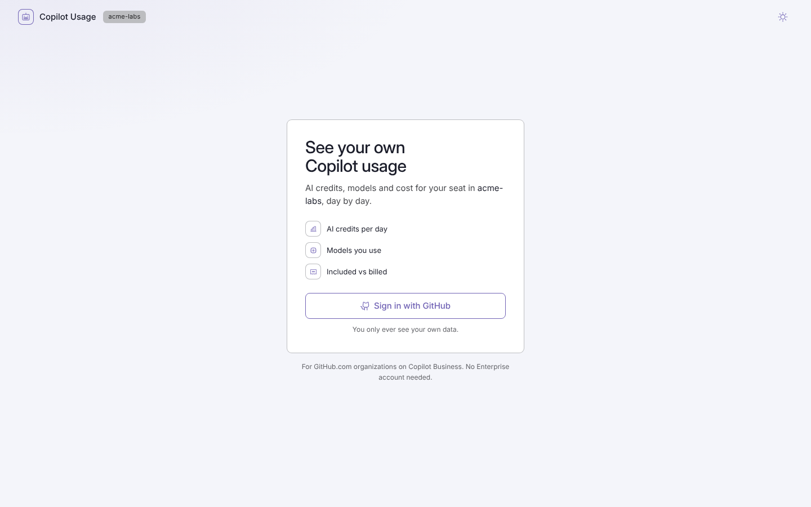

The role is worked out at sign-in, from the person's membership of the organization and its
teams. It decides where they land and what they can open:

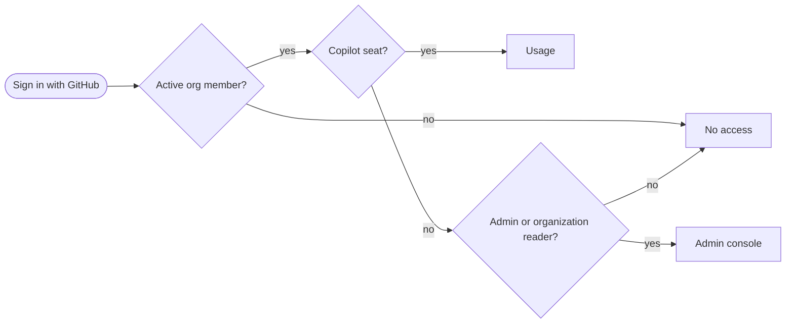

| Role | Who | Sees |
| --- | --- | --- |
| **Member** | every org member with a Copilot seat | their own [Usage](#usage) and [Activity](#activity), nothing about anyone else |
| **Organization reader** | members of the teams in `ACCESS_ORG_READER_TEAMS` | the [admin console](#the-admin-console), read-only, without Sync |
| **Admin** | org owners, plus members of the teams in `ACCESS_ADMIN_TEAMS` | the whole admin console, including [Sync](#sync) |
| outsider, or no seat | anyone else who signs in | the [No access](#no-access) page |

Admins and organization readers who have a seat land on their own Usage, and switch with
**Admin console** and **My usage** in the header. Roles are taken at sign-in: after a change
in GitHub (a new seat, a new team), sign out and in again. Details:
[security.md](security.md#roles).

## Controls on every page

- **Period** (top right): *This cycle* is the current billing month, *Last cycle* the one
  before, *Custom* any range of days. Below it: the dates, and which day of the cycle it is.
  The period stays the same when moving between pages.
- **Synced … ago** (header): when usage was last fetched from GitHub. If the last successful
  sync is more than 3 hours old (`SYNC_STALE_AFTER_HOURS`), a banner says the numbers may be
  behind.
- **Charts**: switch between *AI credits*, *Tokens* and *Requests*, between *Daily*,
  *Weekly* and *Cumulative*, and between *Chart* and *Table*. Dashed bars are the rest of the
  cycle, projected at the pace so far. Pick a row in the table below a chart to highlight it.
- **CSV**: downloads what the card shows, for the selected period.
- **Theme** (sun or moon icon) and **Sign out** (the arrow at the far right).

## Members: your own usage

### Usage

*Usage* is where members land. It answers: how many AI credits have I used this cycle, where
will I end up, which models did I use, and how close am I to my budget?

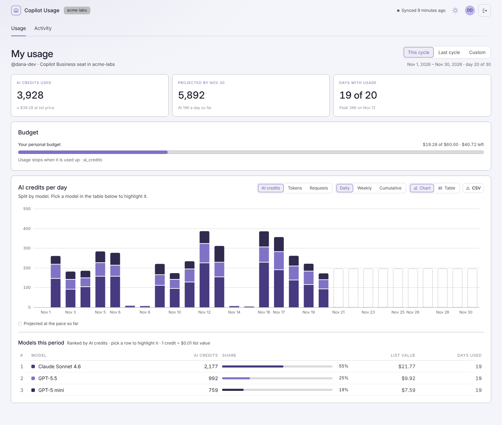

- **AI credits used**, with the list-price value (1 credit = $0.01), **Projected by** the end
  of the cycle at the pace so far, and **Days with usage**, with the busiest day.
- **Budget**: the budget GitHub applies to you (a personal one, or the organization's
  default per-member budget), how much of it is spent this month, and whether usage stops when
  it's used up.
- **AI credits per day**, split by model, and **Models this period**, ranked by credits.

### Activity

*Activity* shows how you work with Copilot, from GitHub's daily usage metrics.

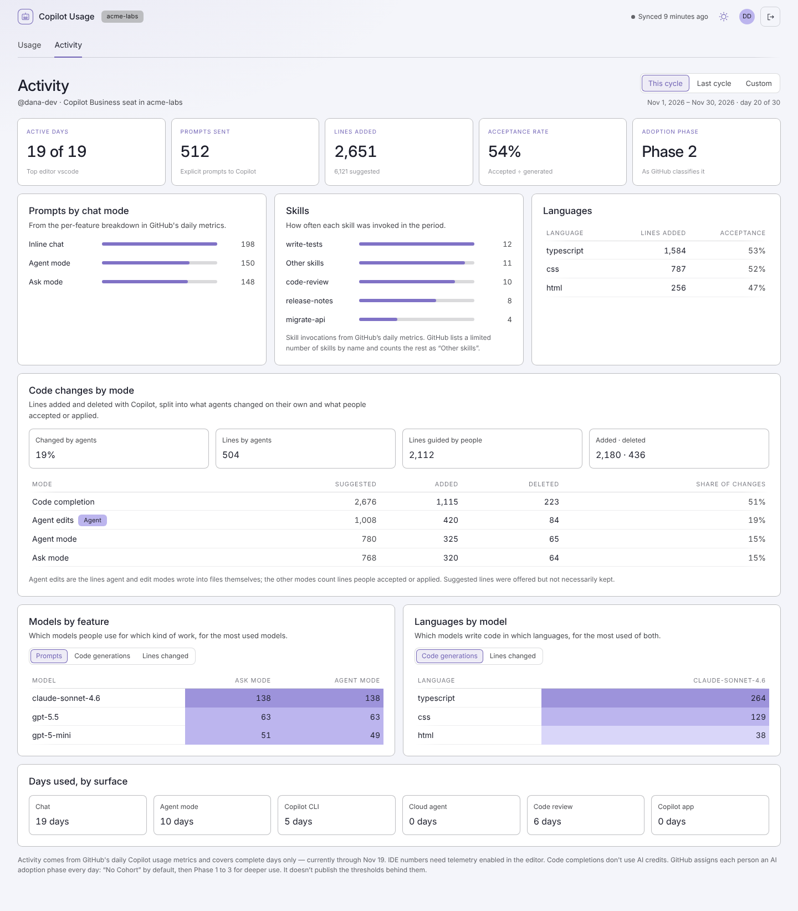

- **Active days**, **Prompts sent**, **Lines added** (and suggested), **Acceptance rate**, and
  the **Adoption phase** GitHub gives you.
- **Prompts by chat mode**, **Skills** and **Languages**.
- **Code changes by mode**: lines that agents wrote into files on their own, compared with
  lines people accepted or applied.
- **Models by feature**, **Languages by model**, and **Days used, by surface** (chat, agent
  mode, CLI, cloud agent, code review, Copilot app).

GitHub publishes these metrics once a day, for complete days, so the page ends at yesterday or
the day before. Editor and language numbers need telemetry enabled in the editor. Code
completions don't use AI credits.

## No access

People who sign in without access see why, and can switch to another GitHub account (for
example their work account instead of a personal one).

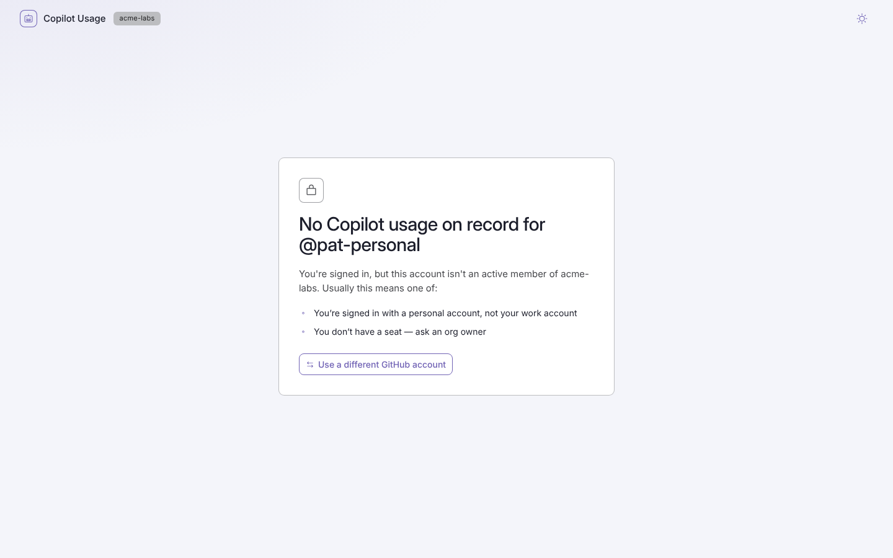

The reasons listed depend on the case. For an org member without a seat, it also mentions that
a newly assigned seat appears after the next sync, within the hour.

## The admin console

The console has a tab per page. The tag next to the organization name says whether you're an
**Admin** or an **Organization reader**. Nothing in the console changes anything in GitHub:
seats and budgets are managed in GitHub itself. The only action is running or stopping a
[sync](#sync).

### Overview

The organization's AI credits and cost this cycle, and where they go.

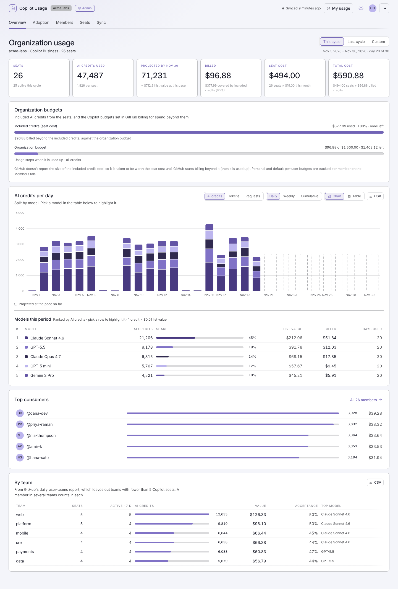

- **Seats**, **AI credits used**, **Projected by** the end of the cycle, **Billed** (what
  wasn't covered by the included credits), **Seat cost** and **Total cost**.
- **Organization budgets**: the included credits (taken to be worth the seat cost, since
  GitHub doesn't report the pool's size) and the organization's Copilot budget for spend
  beyond them.
- **AI credits per day** by model, with the **Models this period** table, including what each
  model was billed.
- **Top consumers**, with a link to all members, and **By team**: seats, people active in the
  last 7 days, credits and value, acceptance rate and top model per team. Pick a team to open
  [its page](#a-team).

### Adoption

Who uses Copilot, how often and for what, from GitHub's daily usage metrics.

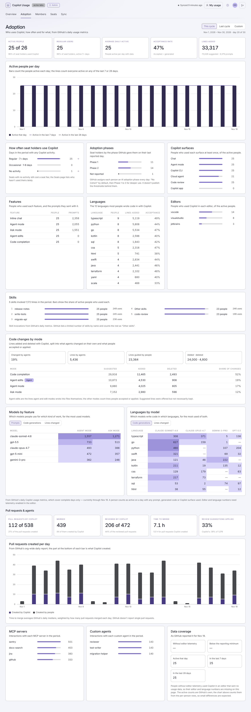

- **Active people**, **Regular users** (active on 7 or more days), **Average daily active**,
  **Acceptance rate** and **Lines added**, then **Active people per day**, with lines for
  everyone active in the last 7 and 28 days.
- **How often seat holders use Copilot**: regular, occasional, or not at all. The arrow next
  to a group opens [Members](#members) filtered to those people. Seats without activity still
  cost a fee: [Seats](#seats) lists them.
- **Adoption phases**, **Copilot surfaces**, **Features**, **Languages**, **Editors**,
  **Skills**, **Code changes by mode**, **Models by feature** and **Languages by model**: the
  organization-wide versions of a member's [Activity](#activity).
- **Pull requests & agents**: pull requests created and reviewed by Copilot, time to merge,
  review suggestions applied, and pull requests per day.
- **MCP servers**, **Custom agents**, and **Data coverage**: how many people the numbers
  include, and who is missing because their editor sends no telemetry.

### A team

A team's page has the same sections as Adoption, for that team's members. Open it from the
**By team** table on the Overview. **Members** at the top opens the [Members](#members) table
filtered to the team.

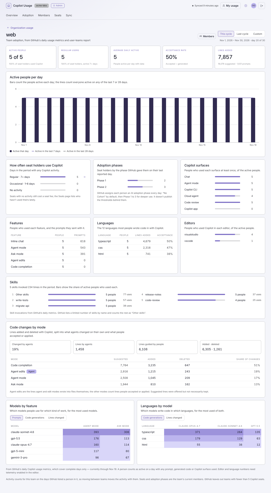

Teams come from GitHub's daily user-teams report, which leaves out teams with fewer than 5
Copilot seats. Someone in several teams counts in each.

### Members

Everyone with a Copilot seat, most AI credits first.

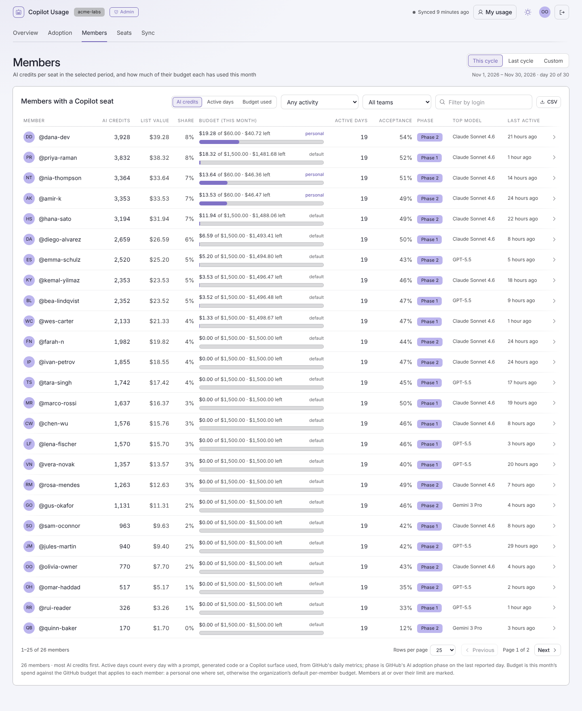

- Sort by **AI credits**, **Active days** or **Budget used**, filter by activity, team or
  login, and download the table as CSV.
- **Budget (this month)** shows each person's spend against the budget that applies to them:
  a *personal* one where set, otherwise the organization's *default* per-member budget.
  Members at or over their limit are marked.
- Pick a row to open [that member's page](#a-member).

### A member

One member's usage, as they see it themselves, plus how they compare with the organization.

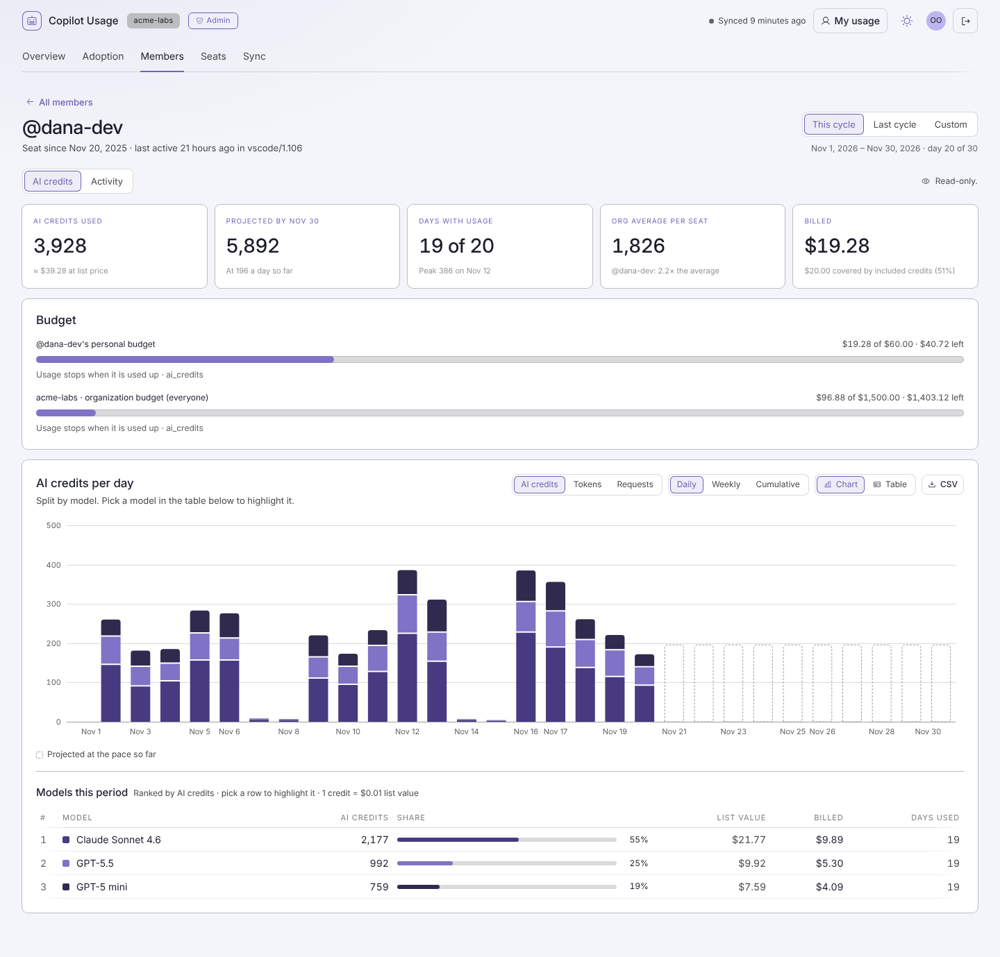

- **AI credits** is the member's [Usage](#usage), plus the **Org average per seat** and what
  was **Billed** for them. **Budget** shows their personal budget and the organization's.
- **Activity** switches to the member's [Activity](#activity).
- The header shows when their seat was assigned, and when and in which editor they were last
  active. The page is read-only.

### Seats

Seats that cost money without being used.

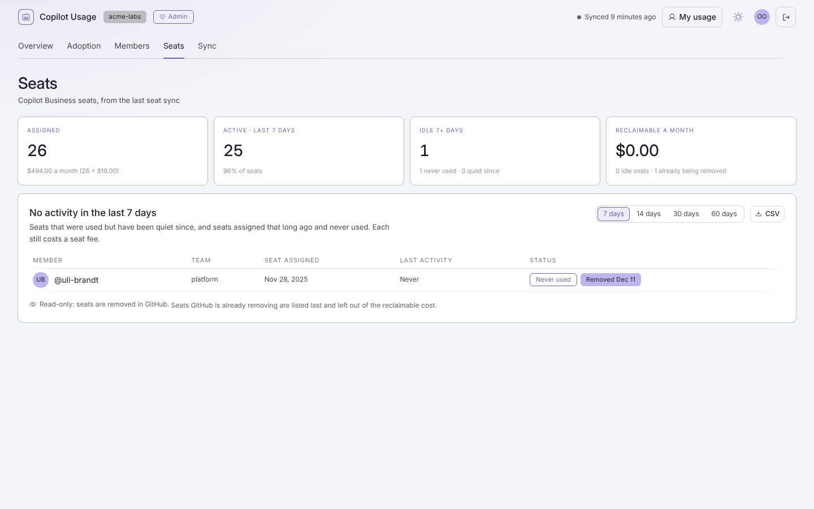

- **Assigned** seats and their monthly cost, **Active** in the last 7 days, **Idle**, and the
  cost **Reclaimable a month** by removing the idle seats.
- **No activity in the last 7 days** (or 14, 30, 60): seats that went quiet, and seats that
  were never used. Seats GitHub is already removing are listed last and left out of the
  reclaimable cost.

Seats are removed in GitHub, not here.

### Sync

*Admins only.* Where the numbers come from, and running a sync on demand.

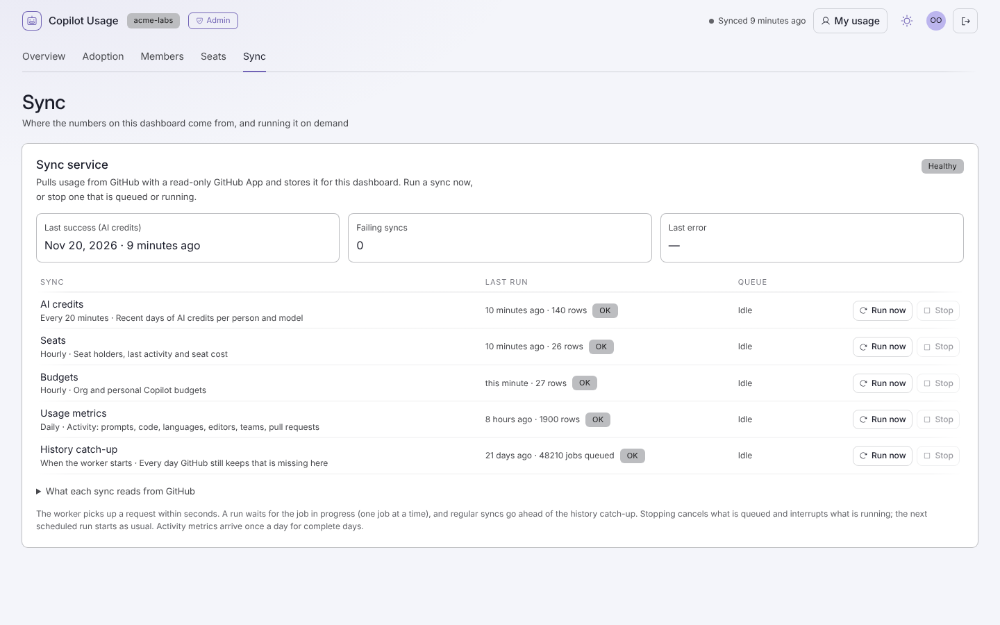

- The service's health, its **Last success**, **Failing syncs** and **Last error**.
- A row per sync (AI credits, seats, budgets, usage metrics, history catch-up), with its
  schedule, last run and queue. **Run now** queues a run; **Stop** cancels what is queued and
  interrupts what is running. The next scheduled run starts as usual.
- *What each sync reads from GitHub* lists the reports behind each one.

When numbers look wrong or old, start here. More in [operations.md](operations.md).

## Organization readers

Organization readers see the same console as admins, with **Organization reader** in the
header and no Sync tab. They can't run or stop a sync.

